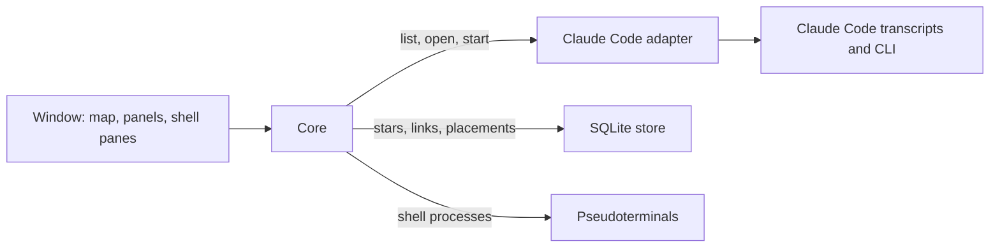

# Design

The first version manages Claude Code sessions on a map of topic stars.

## Model

Deck stores three kinds of record. Sessions stay with the agent that created them.

| Record | Content |
| --- | --- |
| Star | A stable ID, a name and a position on the map. |
| Link | A larger star and a smaller star. |
| Placement | A star and a session key: the agent's name and the session's own ID. |

Deck keeps no copy of a session. It reads the title, folder and last activity from the agent.

- **Top stars.** A star with no larger star is a top star. There is no centre: a universe has a few top stars, such as System, AI and PL.
- **Links.** Every link has a larger and a smaller end; equal stars are never linked. A star may have several larger stars. A link that would place a star under itself is refused. Removing a star's last link makes it a top star.
- **Placements.** A session may sit on several stars. A session on no star is unsorted, which is derived and not stored.
- **Deleting a star.** Its links and placements go with it. A smaller star left without a larger star moves up to the deleted star's larger stars, or becomes a top star. Sessions are never deleted.
- **Counts.** A star counts the distinct sessions on it and on every star beneath it.
- **Missing sessions.** A placed session the agent no longer lists is marked missing, with an offer to remove the placement.

## Universe

A space canvas with pan and zoom. It starts empty.

- **Appearance.** Size follows a star's count. Brightness follows its most recent session activity.
- **Focus.** Selecting a star centres it, highlights its links and opens its sessions.
- **Editing.** Add a top star in empty space or a smaller star under a star. Rename, link by dragging from a larger star to a smaller one, unlink, delete, and move by dragging.
- **Positions.** A new smaller star appears beside its larger star. Stars stay where they are left.

## Sessions

- **Star panel.** The focused star's sessions, most recent first, optionally including smaller stars. Each row shows the title, folder, last activity and other stars. Open a session, add it to another star, or remove it from this one.
- **Unsorted tray.** Every session on no star. Search by title or folder, then drag sessions onto a star.
- **New session.** From a star, choose a folder. Deck starts Claude Code with a session ID it chose and places the session on that star.

## Shell

Deck has no chat interface. Opening a session opens a shell pane inside Deck's window that runs Claude Code in the session's folder. Its interface, approvals and hooks behave as in any terminal.

- Two panes can sit side by side, and the map stays one key away.
- Closing a pane stops the Claude Code process. The session remains and can be reopened.
- Deck does not guard against a session being open in another client. The agent handles that.

## Claude Code

| Action | Interface |
| --- | --- |
| List | Transcript files, `~/.claude/projects/<project>/<session-id>.jsonl` |
| Title | Last `custom-title` record, else `ai-title`, else `last-prompt` |
| Folder | `cwd` of the first record that has one |
| Last activity | File modification time |
| Open | `claude --resume <id>` in the session's folder |
| Start | `claude --session-id <uuid>` with an ID Deck chooses |

Read from Claude Code 2.1.330 on macOS. The transcript format is undocumented, so Deck reads only these fields and skips sub-agent transcripts in sub-folders. The open and start commands come from the CLI help; running them from Deck is untested.

## Architecture

- **Desktop app.** Built with Tauri: a Rust core and a web view.
- **Adapter.** One per agent, starting with Claude Code. It lists sessions, builds the open command and starts a new session.
- **Store.** One SQLite file in the per-user application data directory. It holds stars, links, placements and the last-used folder, and nothing from a session's content.

## Build order

| Step | Outcome | Acceptance |
| --- | --- | --- |
| 1. Core | The Claude Code adapter, the store, and a command-line tool for both. | Sessions from every project folder appear in one list, including those created in Claude Code's desktop app. |
| 2. Map | Stars, links, positions, the star panel and the unsorted tray. | Stars, links, positions and placements survive a restart. A link that would form a loop is refused. |
| 3. Shell | Open a session; two panes side by side. | A turn sent in the shell is present when the session is next opened outside Deck. |
| 4. New session | Start a session from a star. | The new session appears on that star at once. |
| 5. Import | Create stars from a folder tree. | A nested folder becomes a star under its parent folder's star. |

## Later

- **More agents.** Codex and OpenCode.
- **Star prompts.** A prompt per star, inherited by sessions started on the stars beneath it. The order for a star with several larger stars is undecided.
- **Skills, system load and memory.** Browse and edit agent skills, watch host load, and review Noema memory through Noema's own tools.
- **Session links.** Fork, reference and handoff relations between sessions.
- **Suggested placement.** Propose a star for an unsorted session.
