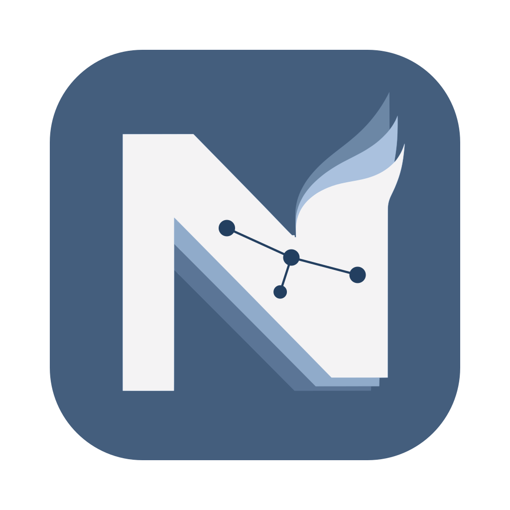
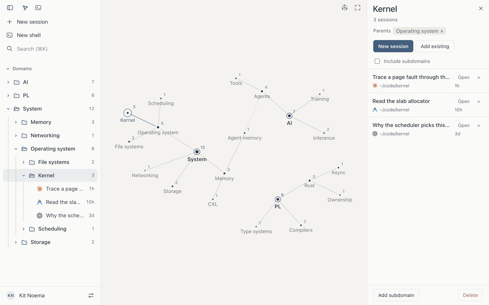
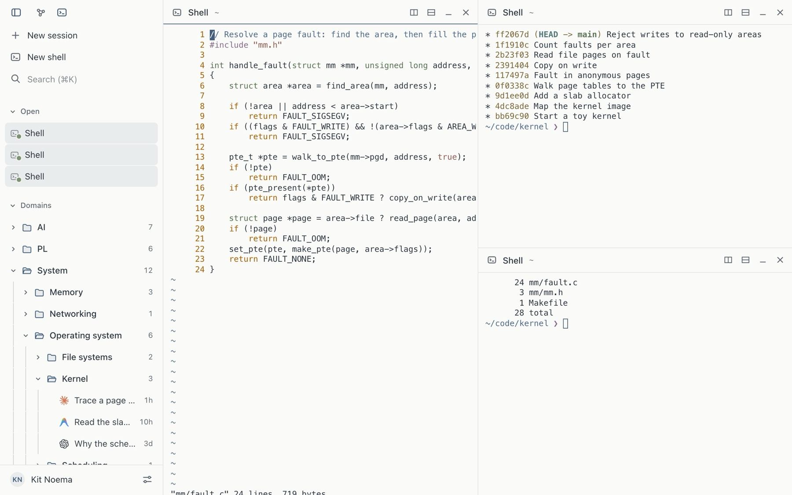
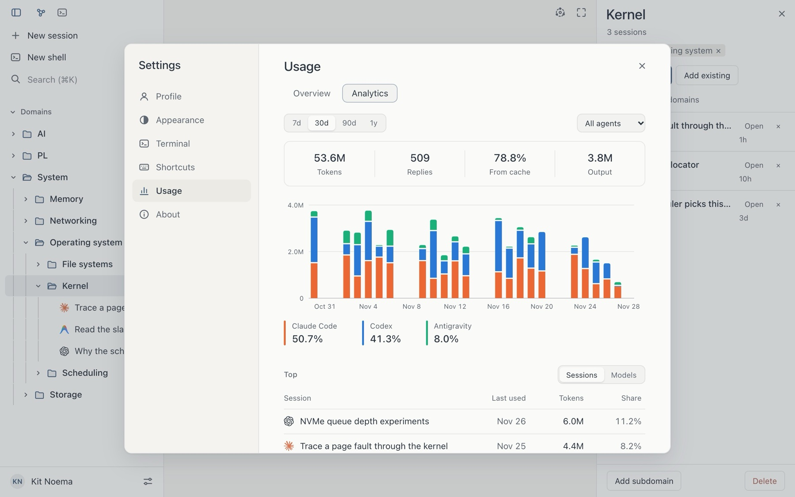
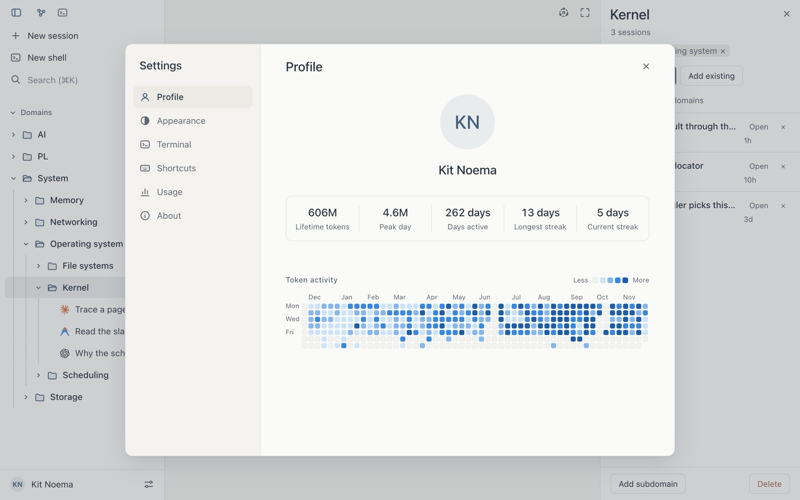

<p align="center">
  
</p>

<h1 align="center">Noema Deck</h1>

<p align="center">
  <b>A map for your Claude Code, Codex and Antigravity sessions.</b><br>
  Sort them by domain, see what you work on, and run each one in a tiled terminal.
</p>

<p align="center">
  <a href="https://github.com/noema-kit/noema-deck/releases/latest"></a>
  
  <a href="LICENSE"></a>
</p>

<p align="center">
  <a href="https://github.com/noema-kit/noema-deck/releases/latest">Download</a> ·
  <a href="docs/design.md">Design</a> ·
  <a href="docs/architecture.md">Architecture</a> ·
  <a href="docs/themes.md">Themes</a>
</p>

<picture>
  <source media="(prefers-color-scheme: dark)" srcset="docs/images/map-dark.jpg">
  
</picture>

## Why

Claude Code, Codex and Antigravity keep every session, but as flat histories, one per agent. Deck adds one idea: **domains**. Put each session in the domains it belongs to, and the map shows what you work on, how the areas connect and where you were busy lately.

## Highlights

- **Domain map.** Domains nest and may have several parents. Size shows how many sessions a domain holds, colour how recently you worked there, and one click lays the map out by depth.
- **Your real sessions.** Deck opens each session in its agent's own interface and stores only which domains it belongs to. No copies, and no chat window of its own.
- **Tiled terminal.** Run sessions and shells side by side, split a pane by dropping another on its edge, and find them where you left them next time.
- **Activity monitor.** Processors, memory, graphics, disks and network over the last two minutes, the busiest processes, and what each open pane's processes add up to.
- **Usage and profile.** Each agent's plan limits, tokens by day, model and session, and a year of activity, read from the agents' own records.
- **Made to fit.** Light and dark, a Galaxy theme, any installed font, zoom, and shortcuts you can rebind.
- **Scriptable.** The same program lists, opens, renames and assigns sessions, counts tokens and reads the machine, from a shell.

<table>
  <tr>
    <td width="50%">
      <picture>
        <source media="(prefers-color-scheme: dark)" srcset="docs/images/terminal-dark.jpg">
        
      </picture>
    </td>
    <td width="50%">
      <picture>
        <source media="(prefers-color-scheme: dark)" srcset="docs/images/usage-dark.jpg">
        
      </picture>
    </td>
  </tr>
  <tr>
    <td align="center"><b>Tiled terminal</b><br>Sessions and shells in rows and columns.</td>
    <td align="center"><b>Usage</b><br>Tokens by day, agent, model and session.</td>
  </tr>
  <tr>
    <td width="50%">
      <picture>
        <source media="(prefers-color-scheme: dark)" srcset="docs/images/profile-dark.jpg">
        
      </picture>
    </td>
    <td width="50%">
      
    </td>
  </tr>
  <tr>
    <td align="center"><b>Profile</b><br>A year of activity, kept on this machine.</td>
    <td align="center"><b>Galaxy</b><br>Domains as stars. <a href="docs/themes.md">Make a theme.</a></td>
  </tr>
</table>

## Install

Download the disk image from [Releases](https://github.com/noema-kit/noema-deck/releases/latest) and move Deck to Applications. It is not notarised, so open it once, then choose **Open Anyway** in System Settings → Privacy & Security. Deck works with [Claude Code](https://github.com/anthropics/claude-code), [Codex](https://github.com/openai/codex) and the Antigravity CLI, `agy`; any one of them is enough.

Or build it with Rust 1.95:

```sh
cargo run -p noema-deck     # the desktop app
cargo run -- serve          # the same interface at http://127.0.0.1:4270
cargo run -- --help         # the command-line tool
```

## Get started

1. **Add a domain.** Double-click the map. Typing a folder path instead imports the folder's tree.
2. **Add sessions.** Start a **New session** in a domain with any of the three agents, or bring in past ones with **Add existing**.
3. **Work.** Click a session to open it. ⌘D splits the pane, ⌘1, ⌘2 and ⌘3 switch between map, terminal and monitor, ⌘= and ⌘− zoom, and ⌘, opens Settings.

## How it works

- **The agents own the sessions.** Deck reads their records and runs `claude --resume`, `codex resume` or `agy --conversation`. It keeps only domains, links and assignments, in one local SQLite file.
- **The core owns the rules.** A Rust core answers every request with a snapshot of the whole map. The desktop window and a local web server pass requests through unchanged, and the interface only draws.
- **Nothing extra to install.** The interface is plain HTML and JavaScript with no build step. Panes run your login shell, and Deck uses your installed fonts.

## Documentation

| | |
| --- | --- |
| [Design](docs/design.md) | What Deck does, and why |
| [Architecture](docs/architecture.md) | How it is built |
| [Themes](docs/themes.md) | How to make a theme |
| [Development](docs/development.md) | Building, testing and releasing |

Deck is the first tool of [Noema Kit](https://github.com/noema-kit), a set of tools for an AI-native personal knowledge system.

## Licence

[MIT](LICENSE)
