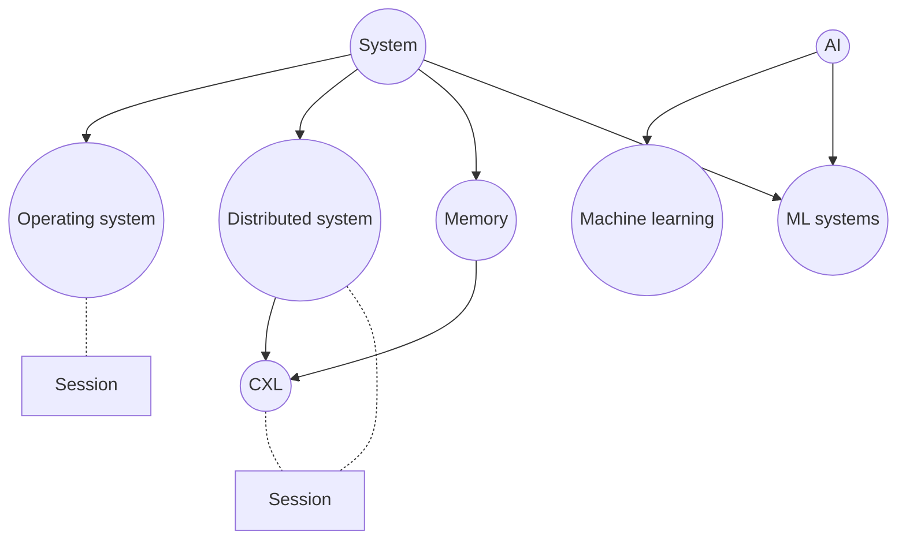

# Noema Deck

A desktop workbench that arranges your Claude Code sessions on a universe of topic stars.

Deck is the first part of [Noema Kit](https://github.com/noema-kit), a set of tools for building an AI-native personal knowledge system.

**Status:** design stage. There is no code yet. See the [design](DESIGN.md).

## Design targets

- **Sessions by topic.** A flat list stops helping after hundreds of sessions. A star is a topic, smaller stars hang under larger ones, and each star holds the sessions that belong to it. A star can hang under several stars, and a session can sit on several.
- **Original sessions.** Deck manages the sessions the agent itself creates. It records only where a session sits and keeps no copy.
- **The agent's own interface.** Opening a session opens a shell pane that runs the agent. Deck has no chat interface, and two panes can sit side by side.
- **Claude Code first.** Codex and OpenCode follow.
- **Standalone.** Deck works without the rest of Noema Kit.
- **Room to grow.** Stars later carry prompts, skills, system load and memory, so Deck becomes one dashboard for agent work.

## Licence

[MIT](LICENSE)
