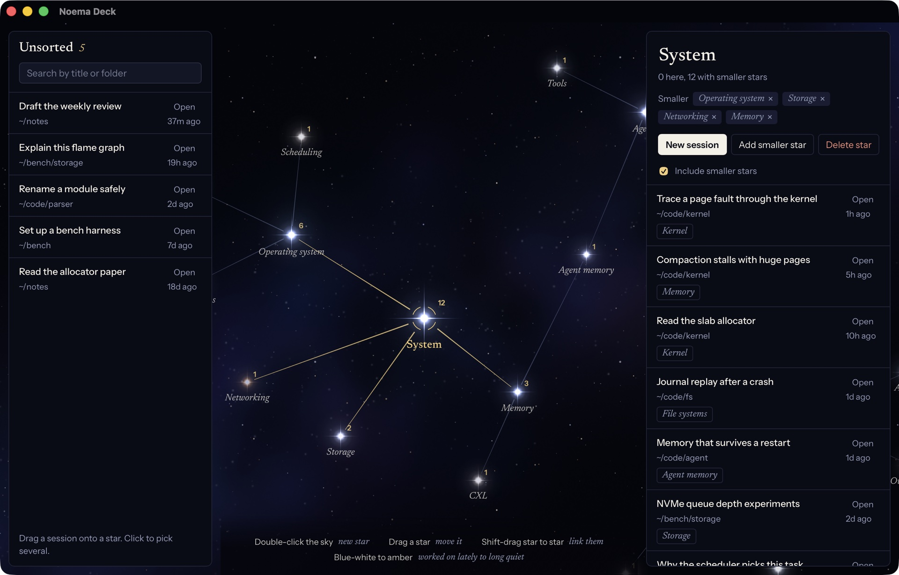

<p align="center">
  
</p>

<h1 align="center">Noema Deck</h1>

<p align="center">A desktop workbench that arranges your Claude Code sessions on a universe of topic stars.</p>



Deck is the first part of [Noema Kit](https://github.com/noema-kit), a set of tools for building an AI-native personal knowledge system.

## Design targets

- **Sessions by topic.** A star is a topic, smaller stars hang under larger ones, and each star holds its sessions. A star can hang under several stars, and a session can sit on several.
- **Original sessions.** Deck manages the sessions the agent itself creates. It records only where a session sits and keeps no copy.
- **The agent's own interface.** Opening a session opens a shell pane that runs the agent. Deck has no chat interface.
- **Claude Code first.** Codex and OpenCode follow.
- **Room to grow.** Stars later carry prompts, skills, system load and memory.

## Run

Requires Rust 1.95 and Claude Code sessions on this machine.

```sh
cargo run -p noema-deck         # the desktop window
cargo run -- serve              # the same map at http://127.0.0.1:4270
```

| On the map | Action |
| --- | --- |
| Double-click empty space | Add a top star, or import a folder's tree by typing its path |
| Click a star | Focus it and list its sessions |
| Drag a star | Move it |
| Shift-drag from a larger star to a smaller one | Link them |
| Drag a session onto a star | Place it there |
| **Open** on a session | Run it in a shell pane; two fit side by side |
| **New session** on a focused star | Start a session already placed on that star |
| ⌘1 and ⌘2, or Ctrl+1 and Ctrl+2 | Switch between the map and the shell panes |

A star's colour tells how lately it was worked on: blue-white today, cooling to amber over three months.

The same program is a command-line tool when given a command, and `noema-deck --help` lists them all:

```sh
noema-deck star add "Operating system" --under System
noema-deck place <session-id-prefix> "Operating system"
noema-deck open <session-id-prefix>
```

## Documents

| Document | Content |
| --- | --- |
| [Design](docs/design.md) | What Deck is and how it behaves. |
| [Architecture](docs/architecture.md) | The crates, the core's modules and how a request flows. |
| [Development](docs/development.md) | Running, checking and conventions. |

## Licence

[MIT](LICENSE)
