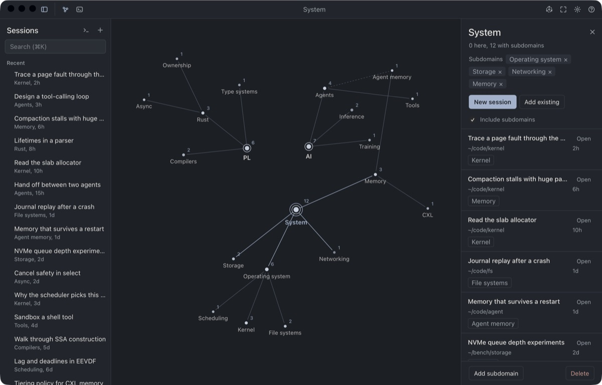

<p align="center">
  
</p>

<h1 align="center">Noema Deck</h1>

<p align="center">A desktop workbench that organises Claude Code sessions by domain.</p>


<p align="center">
  
  
</p>

Deck is the first part of [Noema Kit](https://github.com/noema-kit), a set of tools for building an AI-native personal knowledge system.

## Features

- **Domains.** Group sessions by domain on a map. A domain can have subdomains and several parents, and a session can belong to several domains.
- **Original sessions.** Deck manages the sessions Claude Code creates. It stores only assignments and keeps no copy.
- **Opt-in.** A session appears once it is assigned to a domain. Start one in a domain, or add past ones from the history.
- **Arrange.** One click lays the map out with root domains at the core and deeper subdomains farther out.
- **Themes.** A quiet light and dark default in the Noema Kit's colours, and Galaxy, a night sky. Fonts, including the terminal's, are yours to choose.
- **Terminal.** A session opens in a terminal pane that runs Claude Code. Panes split right or down and tile freely, and a pane can run a plain shell.
- **Continuity.** Open panes reopen at the next start, tiled as they were, and a session that finished out of sight is marked ready.
- **Command line.** The same program lists, opens, renames and assigns sessions from a shell.

## Run

Requires Rust 1.95 and Claude Code.

```sh
cargo run -p noema-deck         # the desktop window
cargo run -- serve              # the same interface at http://127.0.0.1:4270
cargo run -- --help             # the commands
```

## Use

| Action | How |
| --- | --- |
| Add a domain | Double-click the map. A folder path imports its tree. |
| See every domain | The arrange button in the top bar lays the map out, and the frame button fits it |
| Move or link domains | Drag one. Shift-drag from a parent to a subdomain. |
| Assign a session | Drag it from the list or the domain panel onto a domain |
| Start a session | **New session** in the domain panel, or `+` in the session list. A name is optional. |
| Add past sessions | **Add existing** in the domain panel |
| Open a session | Click it, or drag it into the terminal: onto a pane's edge to split there, or onto its middle to replace it |
| Move a pane | Drag its header onto another pane's edge or middle |
| Open a shell | `>_` in the session list, or split a pane |
| Rename a session or shell | Double-click its row or its pane's title |
| Resize | Drag the edge of the session list or the domain panel, or a divider between panes |
| Change the look | The sun in the top bar opens Appearance: theme, light or dark, and fonts |

| Key | Action |
| --- | --- |
| ⌘1, ⌘2 | Map, terminal |
| ⌘B, ⌘K | Session list, search |
| ⌘D, ⇧⌘D | Split the active pane right, down |
| ⌘0 | Show every domain |
| ⌘, | Appearance |

Off macOS, the number keys take Ctrl and the letter keys take Ctrl+Shift.

## Documents

| Document | Content |
| --- | --- |
| [Design](docs/design.md) | What Deck does. |
| [Themes](docs/themes.md) | How a theme is made. |
| [Architecture](docs/architecture.md) | How it is built. |
| [Development](docs/development.md) | Running, checking and conventions. |

## Licence

[MIT](LICENSE)
