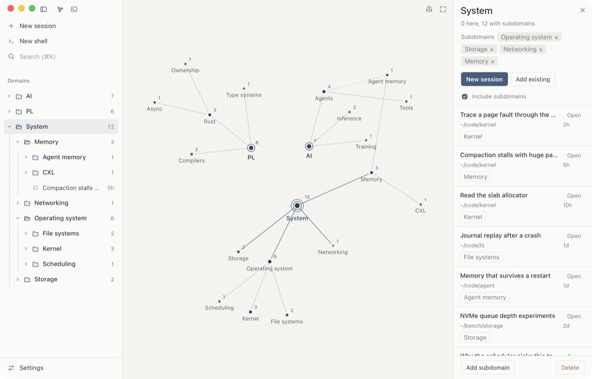
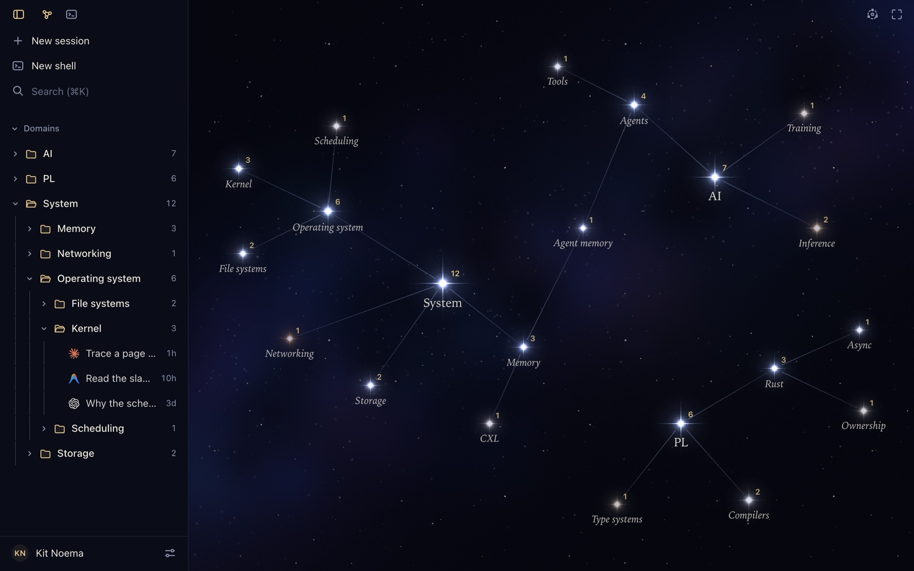

<p align="center">
  
</p>

<h1 align="center">Noema Deck</h1>

<p align="center">
  <b>A map for your Claude Code and Codex sessions.</b><br>
  Sort them by domain, see what you work on, and run each one in a tiled terminal.
</p>

<p align="center">
  <a href="https://github.com/noema-kit/noema-deck/releases/latest"></a>
  
  <a href="LICENSE"></a>
</p>

<p align="center">
  <a href="https://github.com/noema-kit/noema-deck/releases/latest">Download</a> ·
  <a href="docs/design.md">Design</a> ·
  <a href="docs/architecture.md">Architecture</a> ·
  <a href="docs/themes.md">Themes</a>
</p>

<picture>
  <source media="(prefers-color-scheme: dark)" srcset="docs/images/dark.jpg">
  
</picture>

## Why

Claude Code and Codex keep every session, but as flat histories, one per agent. Deck adds a single idea: **domains**. Put each session in the domains it belongs to, and the map shows what you work on, how the areas connect and where you were busy lately.

## Highlights

- **Domain map.** Domains nest and may have several parents. Size shows how many sessions a domain holds, colour how recently you worked there. One click lays out the whole map by depth.
- **Your real sessions.** Deck opens Claude Code and Codex sessions in their own interfaces and stores only which domains they belong to. No copies, and no chat window of its own.
- **Tiled terminal.** Run sessions and shells side by side. Drag one onto a pane to split it. Open panes come back where they were.
- **File-tree sidebar.** Browse domains as folders, each session marked with its agent and running ones with their state.
- **Made to fit.** A quiet light and dark theme, Galaxy for a night sky, any installed font, and shortcuts you can rebind.
- **Scriptable.** The same program lists, opens, renames and assigns sessions from a shell.

## Install

Download the disk image from [Releases](https://github.com/noema-kit/noema-deck/releases/latest) and move Deck to Applications. It is not notarised, so open it once, then choose **Open Anyway** in System Settings → Privacy & Security. Deck needs [Claude Code](https://github.com/anthropics/claude-code), [Codex](https://github.com/openai/codex) or both.

Or build it with Rust 1.95:

```sh
cargo run -p noema-deck     # the desktop app
cargo run -- serve          # the same interface at http://127.0.0.1:4270
cargo run -- --help         # the command-line tool
```

## Get started

1. **Add a domain.** Double-click the map. Typing a folder path instead imports the folder's tree.
2. **Add sessions.** Start a **New session** in a domain with Claude Code or Codex, or bring in past ones with **Add existing**.
3. **Work.** Click a session to open it. ⌘D splits the pane, ⌘1 and ⌘2 switch between map and terminal, and ⌘, opens Settings.

## How it works

- **The agents own the sessions.** Deck reads their session files and runs `claude --resume` or `codex resume`. It keeps only domains, links and assignments, in one local SQLite file.
- **The core owns the rules.** A Rust core answers every request with a snapshot of the whole map. The desktop window and a local web server pass requests through unchanged, and the interface only draws.
- **Nothing extra to install.** The interface is plain HTML and JavaScript with no build step. Panes run your login shell, and Deck uses your installed fonts.

## Themes



**Noema**, the default, takes its quiet palette from the Noema Kit mark. **Galaxy** draws domains as stars. A theme is a folder of colours and a map painter, described in [Themes](docs/themes.md).

## Documentation

| | |
| --- | --- |
| [Design](docs/design.md) | What Deck does, and why |
| [Architecture](docs/architecture.md) | How it is built |
| [Themes](docs/themes.md) | How to make a theme |
| [Development](docs/development.md) | Building, testing and releasing |

Deck is the first tool of [Noema Kit](https://github.com/noema-kit), a set of tools for an AI-native personal knowledge system.

## Licence

[MIT](LICENSE)
