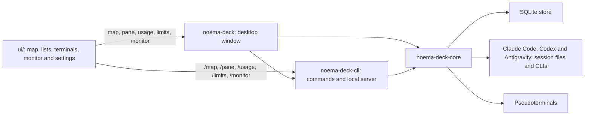
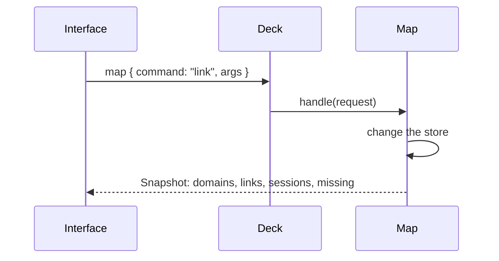

# Architecture

How Deck is built. [Design](design.md) says what it does.

## Crates

| Part | Role |
| --- | --- |
| `noema-deck-core` | Everything Deck knows and does. No window, no arguments, no printing. |
| `noema-deck-cli` | The commands, what they print, and a local server that gives the interface to a browser. |
| `noema-deck` | The Tauri window. Given a command, it hands it to the CLI library, so one program is both the app and the command-line tool. |
| `ui/` | Plain HTML, CSS and JavaScript with no build step. `app.js` sends requests and fills the lists, `map.js` runs the map and hands its drawing to the theme's painter, `theme.js` and `settings.js` put on and change the look, `status.js` reads what the programs in panes say they are doing, `monitor.js` draws the Monitor view, `usage.js` draws the Usage and Profile pages of Settings, `profile.js` keeps the name and picture, and `keys.js` holds the shortcuts. Each theme is a folder in `ui/themes/`. |

## Core modules

| Module | Holds |
| --- | --- |
| `agent`, `agent::claude`, `agent::codex`, `agent::antigravity` | The agents, and one adapter each: list and rename sessions, and the commands that open or start one. |
| `session`, `domain` | The records Deck works with. |
| `store` | The SQLite file: tables and upgrades, domains, assignments, settings. |
| `import` | A folder tree turned into domains laid out on rings. |
| `map` | Domains, links and assignments joined with the agents' sessions. One `Request` goes in and one `Snapshot` comes out. `map::arrange` lays the domains out by depth around one centre. |
| `pane` | Terminal panes on pseudoterminals. |
| `usage`, `usage::claude`, `usage::codex`, `usage::antigravity` | The tokens each agent's records hold, added up by day, model and session. `usage::limits` asks each agent how much of its plan is used. |
| `monitor`, `monitor::processes` | What the machine is doing: processors, memory, graphics, disks and network, every process, and what each pane's processes add up to. |
| `fonts` | The installed typefaces, read once: which share one width, and which draw prompt icons. |
| `deck` | One running Deck: the map behind a lock, the panes, the usage as last read, and the machine's readings. |

## One request, one snapshot

The interface keeps no state of its own about domains or sessions. It sends a request and draws the snapshot that comes back. Requests go one after another, so they reach the core, and their snapshots come back, in the order sent.

Every rule lives in the core: a refused link, a domain's count, which sessions are missing. The window and the server pass the same routes through unchanged, `map`, `pane`, `usage`, `limits`, `monitor` and `fonts`, so the interface behaves the same in both. A snapshot equal to the one on screen is not drawn again. An agent whose records cannot be read, say mid-update, keeps the sessions last read, so the others stay listed and Deck still starts.

## Interface

- **Local storage** holds only layout choices, such as panel widths and folded domains. The panes to reopen, the appearance and the shortcuts go to the store, so they follow the store and not the web view.
- **Session rows** out of sight are not laid out, and the browser knows a row's height only while the row stays in its list. A redraw therefore keeps every row that shows the same and makes only the others, or the rows above a reader would shrink to a guess and the list would slide under them.
- **Look.** The appearance comes in the snapshot and is changed by a request, like everything else. `theme.js` loads the theme's style sheet and painter, sets the mode and typefaces on the page, and restyles the map and every terminal. `boot.js` runs before the page is drawn and puts on the last run's look from local storage, so the window does not flash the default.
- **Title bar.** The window's title bar is an overlay, with its buttons centred on the page's top row. The page marks the regions that drag and zoom the window. One capability file grants it those two calls, zooming the page, and the app's version, for Settings.

## Map drawing

The map is one canvas, because a pan or a zoom repaints every domain on every frame.

- **View and painter.** `map.js` owns the view, its motion, hit testing, names and counts. The theme's painter draws the backdrop, links and domains. [Themes](themes.md#the-painter) gives the interface.
- **A frame only when something changed.** A still map costs nothing.
- **Hit testing is arithmetic.** The domain under the pointer is the nearest one within reach. No element stands for one.

## Store

One SQLite file in the per-user application data directory, beside `limits.json`, which keeps Antigravity's last plan limits. Nothing from a session's content is stored.

| Table | Columns |
| --- | --- |
| `domain` | `id`, `name`, `x`, `y` |
| `link` | `parent`, `child` |
| `assignment` | `domain`, `agent`, `session` |
| `setting` | `name`, `value`: the last folder, the panes to reopen with their layout tree, the appearance, the shortcuts moved to other keys, and the profile's name and picture |

`PRAGMA user_version` counts the upgrade steps a store has had. Opening runs the ones it lacks, and refuses a store from a newer Deck.

## Panes

A pane runs one command on a pseudoterminal: an agent on a session, or the user's login shell.

- **Two threads per pane.** One copies what the process writes. The other waits for the process to end.
- **Ending.** A pane ends when its terminal closes, or shortly after its process exits if something it started holds the terminal open.
- **Many panes.** Any number can run. The interface keeps reading those out of sight too, which is how it knows a session is active.
- **Reading waits.** The interface asks for output and the answer comes when there is some, or after twenty seconds.
- **Writing.** Each pane has a lock of its own for writes, so a program that stops reading holds up only its own pane.
- **Environment.** A desktop app starts without a terminal's `PATH`. Deck asks the login shell for its environment at startup, and again later if it did not answer in time, and runs every pane with it, minus the variables of whatever terminal started Deck, and with `TERM=xterm-256color`, `COLORTERM=truecolor` and `TERM_PROGRAM=NoemaDeck`.
- **State.** A program may tell its terminal what it is doing, by the [Program Status Protocol](https://www.superlogical.com/rex/docs/build/program-status), OSC 7501: idle, working, blocked on a permission, a question or a sign-in, done, or failed. It first asks whether the terminal reads such reports, and reports only once answered, so the page answers, and `status.js` keeps each pane's reports. Deck writes nothing to an agent's settings for this and never reads the screen to guess. Claude Code 2.1.332 and Antigravity 1.5.19 were seen to ask and report. Codex 0.171.0 holds the code but sent nothing, so its panes, like a shell's, go by their output.
- **Drawing.** Each terminal is xterm.js drawing through WebGL, and through plain elements when WebGL is unavailable. The page answers a program's question about light and dark (mode 2031) itself.

## Usage

The `usage` route answers with a `Report`: tokens by day, agent and model, and tokens by session and day. The interface picks the span and the agent itself, so changing either sends no request. The `limits` route answers with each agent's `Plan`, or one agent's: each window's name, the share used and when it starts again.

| Agent | Records read | Counted |
| --- | --- | --- |
| Claude Code | Every transcript under `projects`, sub-agents' in the session's folder included | `message.usage` of each `assistant` record, once per `message.id`: the finished part, else the one with the most output |
| Codex | Rollouts in `sessions` and `archived_sessions`, compressed or not | `last_token_usage` of each `token_count` event whose running total moved, once per time and total. Its cached input is taken out of input. The latest `rate_limits` give the plan limits |
| Antigravity | `brain/<id>/.system_generated/logs/transcript_full.jsonl` of the CLI and of the editor beside it | The tokens of each finished `PLANNER_RESPONSE` step. Its model is the step's own, else the last `Model Selection` chosen |

Tokens come in four kinds: fresh input, input read from the prompt cache, input written to it, and output, reasoning included. A file is read again only when its time or length changes, on as many threads as there are cores: Codex compresses old rollouts, and in a release build the first reading of 2.3 GB of them took 1.8 seconds, against 7 on one thread. Only lines that can hold tokens are parsed.

Claude Code's and Codex's records were read from the versions named below. Antigravity's token fields follow cc-switch's reader, as no conversation on the machine they were tested on had any.

| Agent | Plan limits |
| --- | --- |
| Claude Code | `claude -p /usage`, with no tools, settings or saved session, answered by Claude Code itself without a model. It keeps the answer in `.claude.json` as `cachedUsageUtilization`, whose `limits` Deck reads when it is for the account signed in |
| Codex | `rate_limits` of the latest `token_count` event. A window whose reset has passed was not used since |
| Antigravity | `agy --print /usage --output-format json`: each model group's `5h` and `weekly` buckets, with the share remaining |

Claude Code and Antigravity are asked at most every two minutes and given 45 seconds, each in the login shell's environment, as a pane is: cut off from the proxy the shell sets, `agy` took 31 seconds to answer rather than 5. `agy` leaves a process behind that holds its output open, so what it printed is taken as it comes, not at the end of the pipe. An agent being asked never holds up reading what is already known.

So the pages open on figures at hand:

- **At start**, Deck reads the agents' records and asks both agents in the background. A later reading rereads only the files that changed, in about a tenth of a second.
- **Antigravity's last answer** is kept in `limits.json` beside the store, as `agy` keeps none. Claude Code keeps its own.
- **Each card** asks its own agent, and takes the answer as it comes, showing the last one until then.
- **The desktop window** runs every command on the runtime's threads for blocking work. On its few workers, a handful of panes waiting up to twenty seconds for output would leave every other request in line.

## Monitor

The `monitor` route answers with a `Sample`: the machine as of one reading. Nothing is read until the view asks, which it does every two seconds while it shows.

| Part | Read from |
| --- | --- |
| Processors, load, memory, swap | The `sysinfo` crate. Memory in use is its used figure: programs' own pages, wired pages and the compressor's. The total less what it calls available would pass every page in use for free |
| Graphics | `sysinfo`: the share of time the graphics processor is busy, as its driver reports it |
| Network | `sysinfo`, over the interfaces with a hardware address. A tunnel's traffic is counted again on the interface that carries it, and the loopback's never leaves |
| Disks | `sysinfo`. Every volume of a drive reports the drive's traffic, so the busiest volume speaks for the machine. A volume mounted in two parts is listed once |
| Processes | `ps -A -o pid=,ppid=,user=,rss=,time=,comm=`, and the kernel's count of each process's footprint through the `libproc` crate |

- **Rates.** A reading covers the time since the one before, and a rate is the average over it. A reading more than ten seconds after the last starts afresh and measures for half a second, so the first figures back are current, not an average over the time the view was away. One asked for sooner than half a second after the last waits until then, and a volume mounted since the last reading reports no traffic until the next.
- **Processes.** macOS tells a program nothing about other users' processes, the window server and the system's services among them, but `ps` may read them all. It reports the processor time each has used to a hundredth of a second, and a process's share is what it gained between two readings.
- **Memory.** `ps` knows only the part of a process resident in memory, which leaves out what the system compressed or swapped out: on the machine this was written on, a language server read 5 MB there against a footprint of 1.3 GB. The kernel tells the footprint, the figure Activity Monitor shows, only of the reader's own processes, which covers everything in a pane. Another user's process keeps the resident figure and is marked partial.
- **Panes.** Each pane knows the process it runs. A process counts for a pane when that process is among its ancestors, so an agent's tools and a shell's commands count for their pane. One that outlives what started it belongs to the system from then on.
- **Rows.** A reading changes figures, seldom what there is to show, so the tables keep their rows and take new text. Made again at every reading, the rows of two tables in one redraw sent a scrolled view back to its top in the desktop window's WebKit, though not in Chrome.
- **Charts.** The interface keeps the last two minutes and draws them on canvases, a frame every fifty milliseconds, shifted one reading back so that a line's end is always between two readings. Readings more than three apart are not joined.

Read on macOS 26 on Apple silicon. Linux's `ps` reports processor time only to the second, so shares there would be coarse.

## Local server

`noema-deck serve` gives the same interface to a browser. It listens on this machine only. Because a pane can type into an agent, it answers only its own page and only JSON requests, which a page from another site cannot send. With `NOEMA_DECK_SELFTEST` set, the page runs the self-test, and the server prints its report and exits with its outcome.

## Claude Code

| Action | Interface |
| --- | --- |
| List | Transcript files, `~/.claude/projects/<project>/<session-id>.jsonl` |
| Title | Last `custom-title` record, else `ai-title`, else `last-prompt`, else the first typed prompt or command |
| Rename | Append a `custom-title` record, as `/rename` does, and keep the file's modification time |
| Folder | `cwd` of the first record that has one |
| Last activity | File modification time |
| Open | `claude --resume <id>` in the session's folder |
| Start | `claude --session-id <uuid>` with an ID Deck chooses, and `--name` when named |
| Theme | In a pane, `--settings` swaps Claude Code's theme for its light or dark counterpart to match the pane, for that run only |

Read from Claude Code 2.1.330 on macOS. The transcript format is undocumented, so Deck reads only these fields, and reads a transcript again only when its time or length has changed.

## Codex

| Action | Interface |
| --- | --- |
| List | Rollout files, `~/.codex/sessions/<year>/<month>/<day>/rollout-<time>-<id>.jsonl`, or `.jsonl.zst` once Codex has compressed them. Only sessions from the terminal, editor and desktop apps, as `codex resume` lists them, not sub-agents or non-interactive runs |
| Title | Last name for the session in `~/.codex/session_index.jsonl`, else the first prompt typed. A session with neither is empty and left out |
| Rename | Append a name to `session_index.jsonl`, where `codex resume` also finds sessions by name |
| Folder | `cwd` of the first record, `session_meta` |
| Last activity | File modification time |
| Open | `codex resume <id>` in the session's folder |
| Start | `codex` in the folder. Codex chooses the ID, so Deck holds the session under a stand-in key and takes Codex's ID once Codex lists a new session in that folder, moving its domains and its kept pane along. A name given is written once Codex has stored it |

Read from Codex 0.171.0 on macOS. `CODEX_HOME` moves the folder, as it does for Codex.

## Antigravity

| Action | Interface |
| --- | --- |
| List | Conversation summaries in the SQLite file `~/.gemini/antigravity-cli/conversation_summaries.db`, read only. Only conversations with a step and a file in `conversations/`, as `agy`'s `/resume` lists them, not sub-agents |
| Title | `title` in the conversation's annotations, `annotations/<id>.pbtxt`, else the summary's title, else the first line of the summary's `preview`, its first message. A new conversation has only the preview, so Deck recognises the session it started from its first message |
| Rename | Set `title` in the annotations, where `agy` keeps the names given to conversations and copies them into its summaries |
| Folder | First `file://` URI in the summary's `workspace_uris`, else the folder its last prompt was typed in, from `history.jsonl`. An `agy` started in another folder can write the summary again without one |
| Last activity | The later of the summary's time and the conversation file's modification time |
| Open | `agy --conversation <id>` in the conversation's folder |
| Start | `agy` in the folder. `agy` chooses the ID, so Deck follows the first new conversation in that folder, as for Codex |
| Theme | In a pane, `--settings` swaps a light or dark `colorScheme` for its counterpart to match the pane, for that run only |

Read from the Antigravity CLI, `agy` 1.5.18, on macOS. `agy` always uses that folder. `NOEMA_DECK_ANTIGRAVITY_HOME` points Deck elsewhere, for tests.
