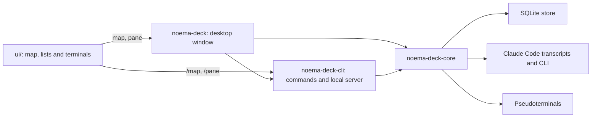
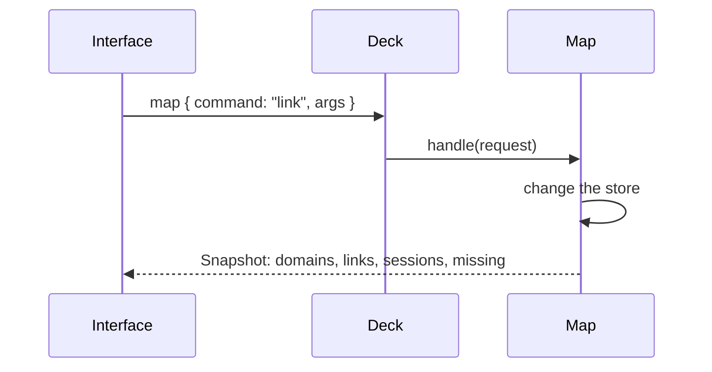

# Architecture

How Deck is built. [Design](design.md) says what it does.

## Crates

| Part | Role |
| --- | --- |
| `noema-deck-core` | Everything Deck knows and does. No window, no arguments, no printing. |
| `noema-deck-cli` | The commands, what they print, and a local server that gives the interface to a browser. |
| `noema-deck` | The Tauri window. Given a command, it hands it to the CLI library, so one program is both the app and the command-line tool. |
| `ui/` | Plain HTML, CSS and JavaScript with no build step. `app.js` sends requests and fills the lists, `map.js` runs the map and hands its drawing to the theme's painter, and `theme.js` and `settings.js` put on and change the look. Each theme is a folder in `ui/themes/`. |

## Core modules

| Module | Holds |
| --- | --- |
| `agent`, `agent::claude` | The agents, and the Claude Code adapter: list sessions, and the commands that open or start one. |
| `session`, `domain` | The records Deck works with. |
| `store` | The SQLite file: tables and upgrades, domains, assignments, settings. |
| `import` | A folder tree turned into domains laid out on rings. |
| `map` | Domains, links and assignments joined with the agent's sessions. One `Request` goes in and one `Snapshot` comes out. `map::arrange` lays the domains out by depth around one centre. |
| `pane` | Terminal panes on pseudoterminals. |
| `fonts` | The installed typefaces, read once: which share one width, and which draw prompt icons. |
| `deck` | One running Deck: the map behind a lock, and the panes. |

## One request, one snapshot

The interface keeps no state of its own about domains or sessions. It sends a request and draws the snapshot that comes back.

Every rule lives in the core: a refused link, a domain's count, which sessions are missing. The window and the server pass the same routes through unchanged, `map`, `pane` and `fonts`, so the interface behaves the same in both. A snapshot equal to the one on screen is not drawn again.

## Interface

- **No state of its own.** Domains and sessions come only from snapshots. The page keeps layout choices alone, such as panel widths, in its local storage. The panes to reopen and their layout go to the store, so they follow the store and not the web view.
- **Look.** The appearance comes in the snapshot and is changed by a request, like everything else. `theme.js` loads the theme's style sheet and painter, sets the mode and typefaces on the page, and restyles the map and every terminal. `boot.js` runs before the page is drawn and puts on the last run's look from local storage, so the window does not flash the default.
- **Title bar.** The window's title bar is an overlay, with its buttons centred in the page's top bar. The page marks the regions that drag and zoom the window, and one capability file grants it those two calls.

## Map drawing

The map is one canvas, because a pan or a zoom repaints every domain on every frame.

- **View and painter.** `map.js` owns the view, its motion, hit testing, names and counts. The theme's painter draws the backdrop, links and domains. [Themes](themes.md#the-painter) gives the interface.
- **A frame only when something changed.** A still map costs nothing.
- **Hit testing is arithmetic.** The domain under the pointer is the nearest one within reach. No element stands for one.

## Store

One SQLite file in the per-user application data directory. Nothing from a session's content is stored.

| Table | Columns |
| --- | --- |
| `domain` | `id`, `name`, `x`, `y` |
| `link` | `parent`, `child` |
| `assignment` | `domain`, `agent`, `session` |
| `setting` | `name`, `value`: the last folder, the panes to reopen with their layout tree, and the appearance |

`PRAGMA user_version` counts the upgrade steps a store has had. Opening runs the ones it lacks, and refuses a store from a newer Deck.

## Panes

A pane runs one command on a pseudoterminal: Claude Code on a session, or the user's login shell.

- **Two threads per pane.** One copies what the process writes. The other waits for the process to end.
- **Ending.** A pane ends when its terminal closes, or shortly after its process exits if something it started holds the terminal open.
- **Many panes.** Any number can run. The interface shows one or two and keeps reading the rest, which is how it knows a session is active.
- **Reading waits.** The interface asks for output and the answer comes when there is some, or after twenty seconds.
- **Environment.** A desktop app starts without a terminal's `PATH`. Deck asks the login shell for its environment once, at startup, and runs every pane with it.
- **Drawing.** Each terminal is xterm.js drawing through WebGL, and through plain elements when WebGL is unavailable.

## Local server

`noema-deck serve` gives the same interface to a browser. It listens on this machine only. Because a pane can type into an agent, it answers only its own page and only JSON requests, which a page from another site cannot send.

## Claude Code

| Action | Interface |
| --- | --- |
| List | Transcript files, `~/.claude/projects/<project>/<session-id>.jsonl` |
| Title | Last `custom-title` record, else `ai-title`, else `last-prompt`, else the first typed prompt or command |
| Rename | Append a `custom-title` record, as `/rename` does, and keep the file's modification time |
| Folder | `cwd` of the first record that has one |
| Last activity | File modification time |
| Open | `claude --resume <id>` in the session's folder |
| Start | `claude --session-id <uuid>` with an ID Deck chooses, and `--name` when named |
| Theme | In a pane, `--settings` swaps Claude Code's theme for its light or dark counterpart to match the pane, for that run only |

Read from Claude Code 2.1.330 on macOS. The transcript format is undocumented, so Deck reads only these fields, and reads a transcript again only when its time or length has changed.
